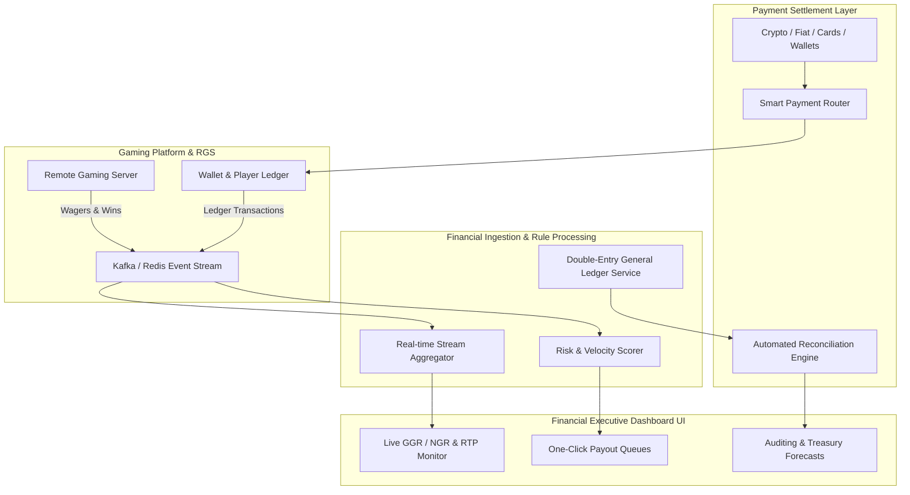

# Master Plan: Financial Executive Real-Time Operations & Settlement Platform

## 1. Executive Summary & Vision

The objective of this initiative is to architect, build, and deploy an enterprise-grade **Real-Time Financial Executive Monitoring, Risk Management, and Payment Settlement Suite** tailored for our iGaming and game engine platform (`ice_fishing` / platform core). 

The platform will empower the **Chief Financial Officer (CFO), Treasury Managers, Financial Executives, and Risk Operations teams** with:
1. **Live Financial Telemetry**: Sub-second visibility into Gross Gaming Revenue (GGR), Net Gaming Revenue (NGR), RTP drift, player balance exposures, and concurrent wagering volume.
2. **Automated Payment & Liquidity Lifecycle**: Orchestration of deposits, withdrawals, multi-PSP routing, reserve rebalancing, and payout approvals.
3. **Anomaly & Fraud Guardrails**: Real-time detection of high-velocity cashouts, syndicate betting, arbitrage, balance mismatches, and sudden RTP spikes.
4. **Audit, Reconciliation & Statutory Compliance**: Immutable double-entry bookkeeping, automated daily end-of-day (EOD) multi-gateway reconciliation, and tax/regulatory export pipelines.

---

## 2. Core Pillars & Architecture

---

## 3. High-Priority Functional Modules

1. **Executive Real-Time Dashboard**
   - Live KPI counters: Total Bets, Total Payouts, Net Hold %, Active Floating Balance, Active Players.
   - Per-game breakdown: Live RTP vs Theoretical RTP, volatility distribution, largest active round exposures.
   - Geographic & Currency breakdown: Multi-currency balance conversion to baseline executive currency (USD/EUR) at spot rates.

2. **Payment Operations & Cashflow Engine**
   - Unified Gateway Hub: Fiat PSPs, Open Banking, Credit Cards, Alternative Payment Methods (APMs), and Crypto Wallets.
   - Smart Routing: Dynamic fallback routing based on PSP fees, success rates, latency, and bank downtime.
   - Treasury & Float Management: Monitoring hot wallet balances, PSP bank settlement windows, and liquidity reserve alerts.

3. **Risk, Fraud & Withdrawal Approvals**
   - Velocity-based rule engine: Flags rapid sequential cash-outs, bonus abuse, or player balance jumps.
   - Tiered manual vs. automated approval workflows:
     - Tier 1 (< $500): Instant automated release if KYC verified and risk score = 0.
     - Tier 2 ($500 - $5,000): Fast-track financial officer approval.
     - Tier 3 (> $5,000): Dual-authorization (Fin Exec + Head of Risk / CFO).

4. **Automated Reconciliation & Audit Trail**
   - EOD 3-way reconciliation: RGS Bet Logs vs. Internal Wallet Ledger vs. External PSP Statements.
   - Exception Manager: Flagging and tracking chargebacks, dropped callbacks, orphaned deposits, and double credits.

---

## 4. Documentation Suite Index

This directory (`financial application solution development and startup phase`) contains the foundational blueprints and delivery specifications:

1. [01_system_architecture_and_data_flow.md](file:///d:/Codes/ice_fishing/financial%20application%20solution%20development%20and%20startup%20phase/01_system_architecture_and_data_flow.md) - High-throughput ingestion, microservices topology, and database models.
2. [02_executive_dashboard_and_realtime_kpis.md](file:///d:/Codes/ice_fishing/financial%20application%20solution%20development%20and%20startup%20phase/02_executive_dashboard_and_realtime_kpis.md) - UI/UX layout, critical financial metrics, telemetry charts, and alerting rules.
3. [03_payments_gateway_settlement_and_treasury.md](file:///d:/Codes/ice_fishing/financial%20application%20solution%20development%20and%20startup%20phase/03_payments_gateway_settlement_and_treasury.md) - PSP orchestration, payout authorization pipelines, hot/cold wallet management, and fee optimization.
4. [04_risk_fraud_and_anomaly_detection.md](file:///d:/Codes/ice_fishing/financial%20application%20solution%20development%20and%20startup%20phase/04_risk_fraud_and_anomaly_detection.md) - Real-time fraud detection, syndicate tracking, balance invariant checks, and risk scoring matrices.
5. [05_implementation_roadmap_and_resourcing.md](file:///d:/Codes/ice_fishing/financial%20application%20solution%20development%20and%20startup%20phase/05_implementation_roadmap_and_resourcing.md) - Phase breakdown (Startup, Alpha, Beta, Production), sprint plans, team sizing, and estimated throughput efforts.
