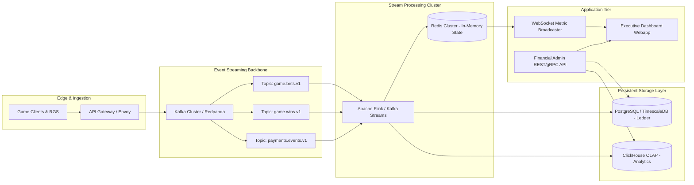

# System Architecture & Real-Time Data Flow

## 1. Overview & Architectural Goals

The Financial Application Engine requires sub-second processing latency for high-throughput gameplay events (spins, bets, wins, cashouts) while guaranteeing absolute consistency and zero data loss for financial records.

### Key Non-Functional Requirements:
- **Throughput**: Support peak capacity of 5,000+ financial transactions per second (TPS) during high-traffic campaigns.
- **Latency**: Sub-250ms real-time metric calculation from game round finish to executive dashboard display.
- **Data Integrity**: Acid-compliant double-entry ledgering with cryptographic hash chaining for all monetary mutations.
- **Availability**: 99.99% uptime with multi-region failover.

---

## 2. Infrastructure Topology



---

## 3. Data Ingestion & Stream Processing Pipeline

### 3.1 Event Contracts
1. **Bet Event (`game.bet.placed`)**:
   ```json
   {
     "event_id": "uuid-v4",
     "timestamp": "2026-10-23T12:00:00.123Z",
     "round_id": "RND-9843219",
     "player_id": "USR-10821",
     "game_id": "ice_fishing_classic",
     "currency": "EUR",
     "amount": 10.00,
     "wallet_balance_before": 250.00,
     "wallet_balance_after": 240.00,
     "device_meta": { "ip": "185.22.1.10", "platform": "desktop" }
   }
   ```
2. **Win/Settlement Event (`game.round.settled`)**:
   ```json
   {
     "event_id": "uuid-v4",
     "timestamp": "2026-10-23T12:00:02.450Z",
     "round_id": "RND-9843219",
     "player_id": "USR-10821",
     "game_id": "ice_fishing_classic",
     "currency": "EUR",
     "bet_total": 10.00,
     "win_total": 35.00,
     "net_payout": 25.00,
     "multiplier": 3.5,
     "wallet_balance_after": 275.00
   }
   ```
3. **Payment Event (`payment.transaction.updated`)**:
   ```json
   {
     "tx_id": "TXN-881204",
     "player_id": "USR-10821",
     "type": "WITHDRAWAL",
     "psp_reference": "STRIPE-CHG-992",
     "amount": 200.00,
     "currency": "EUR",
     "fee_charged": 2.50,
     "status": "SETTLED",
     "initiated_at": "2026-10-23T12:15:00Z",
     "settled_at": "2026-10-23T12:15:18Z"
   }
   ```

---

## 4. Ledger & Analytical Storage Strategy

### 4.1 Hybrid Storage Model
- **OLTP & Double-Entry Ledger (PostgreSQL)**:
  - Enforces debit/credit balancing: `Sum(Debit) - Sum(Credit) == 0`.
  - Holds player wallets, PSP accounts, platform revenue hold, bonus liability balances.
  - Immutable append-only audit entries.
- **Real-Time State & Counters (Redis)**:
  - 1-second, 1-minute, and 1-hour rolling sliding window metrics (Active turnover, GGR, Payout ratio).
  - Current platform exposure and instantaneous hot wallet balances.
- **OLAP Analytical Data Store (ClickHouse)**:
  - Columnar storage optimized for instant multi-million row aggregations across player segments, games, time windows, and geo-regions.
  - Empowers CFO dynamic drill-down queries without impacting transactional game operations.

---

## 5. Security, Isolation & Audit Guardrails

1. **Role-Based Access Control (RBAC)**: Fine-grained permissions isolating Financial Ops, Risk Managers, Compliance Officers, and C-Suite.
2. **Mutual TLS (mTLS)**: Enforced across all internal microservice calls and between RGS and Financial Core.
3. **Hardware Security Module (HSM) / Key Vault**: Payout signing keys and PSP credentials never leave isolated vaults.
4. **Audit Immutability**: All adjustments, manual overrides, and manual payout releases are cryptographically signed with the administrator's identity and reason code.
