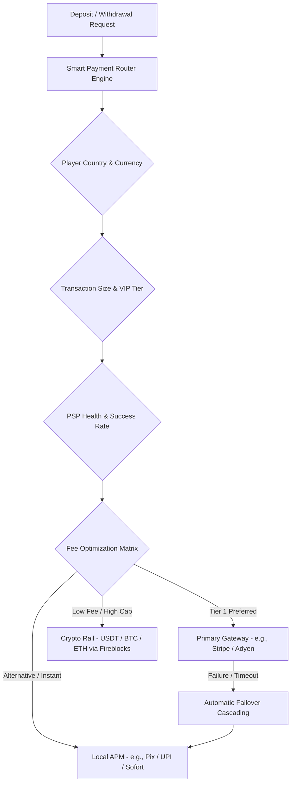
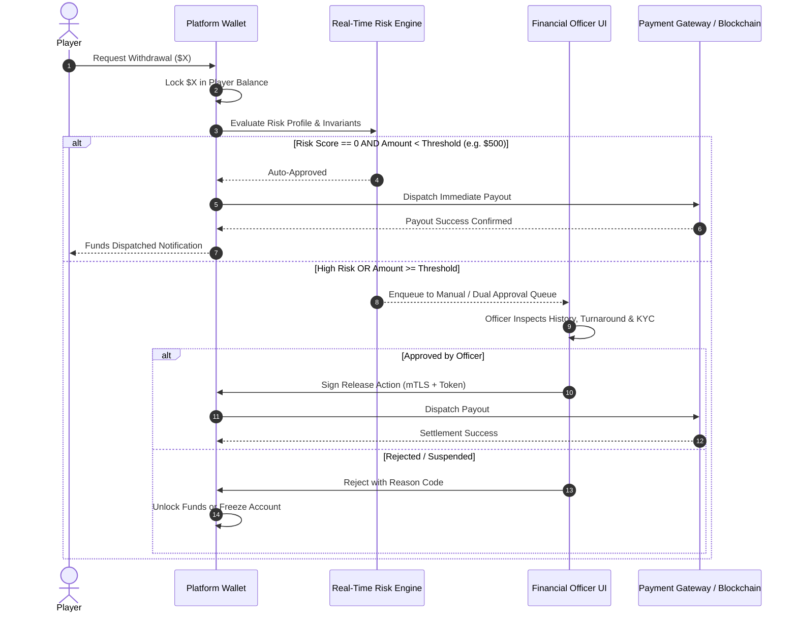
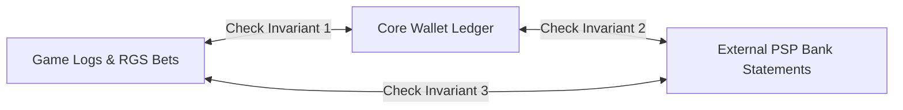

# Payments Gateway, Settlement & Treasury Management

## 1. Overview & Strategy

The payment subsystem is the financial circulatory system of the gaming platform. The goal is to maximize deposit conversion rates, eliminate payout friction for legitimate players, optimize processing fees, and safeguard operational liquidity across multiple currencies and rails.

---

## 2. Multi-PSP Routing Architecture

To mitigate single-point-of-failure risks and optimize fee structures, the platform employs a **Dynamic Smart Payment Router (DSPR)**.

### Routing Logic Variables:
1. **Health Score**: Real-time probe of PSP uptime and 5-minute rolling success rate. If success drops below 85%, traffic cascades to secondary providers.
2. **Interchange & Blended Fee Matrix**: Routing low-margin transactions to lowest-cost processing rails.
3. **Player History**: Prioritize the exact payment method and card token previously authorized and verified.

---

## 3. Withdrawal Authorization Pipeline

---

## 4. Treasury & Liquidity Float Management

### 4.1 Multi-Tier Wallet Architecture (Crypto & Fiat)
1. **Hot Wallet (Operational)**:
   - Holds 10%–15% of expected 24h payout volume.
   - Fully automated payouts for fast player experience.
2. **Warm Wallet / Treasury Operating Account**:
   - Holds 25%–35% of liquidity.
   - Requires multi-signature (2-of-3) execution to replenish Hot Wallets.
3. **Cold Storage / Escrow Reserve**:
   - Holds 50%+ of player liability reserves.
   - Complete air-gapped isolation with executive custodian controls.

### 4.2 Automated Rebalancing & Sweep Rules
- **Automatic Top-up**: If Hot Wallet drops below $50,000 equivalent, trigger warm-wallet rebalance alert and pre-staged transfer.
- **EOD Profit Sweep**: Excess funds generated from daily GGR over baseline liquidity reserve are swept nightly to corporate treasury reserves.

---

## 5. Daily 3-Way Reconciliation Engine

Reconciliation runs continuously with an immutable EOD freeze at 00:00:00 UTC.

- **Invariant 1**: `Opening Balance + Deposits - Withdrawals + Wins - Bets + Adjustments == Closing Balance`.
- **Invariant 2**: Every debit in the wallet ledger destined for external transfer matches an authenticated gateway settlement ID.
- **Discrepancy Resolution**: Any mismatch > $0.01 triggers an exception ticket assigned to the Treasury Specialist, locking affected account balances from cashout.
