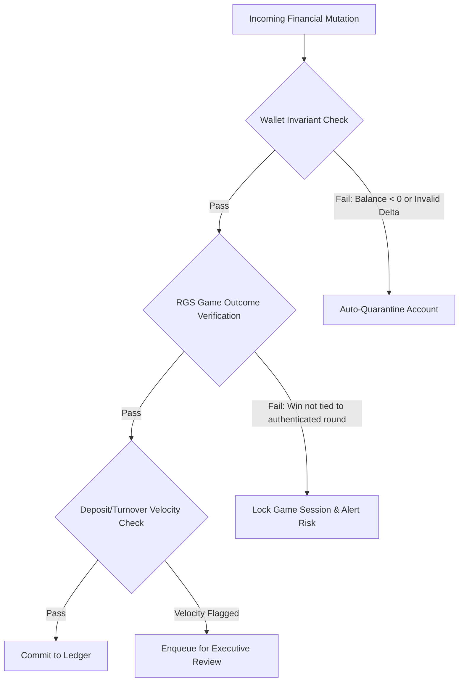

# Risk, Fraud & Financial Anomaly Detection

## 1. Objectives

The Risk & Anomaly Detection Engine operates in parallel with the live game engine and payment gateways to prevent capital depletion caused by game logic exploits, bonus manipulation, account takeovers, collusion, chargeback syndicates, or technical desynchronization.

---

## 2. Invariant Auditing Engine (Financial Zero-Trust)

Every financial balance mutation is validated against deterministic mathematical laws:

### Core Invariants:
1. **Wallet Balance Monotonicity**: A player's real-money wallet can never be negative under any circumstance.
2. **Deterministic Round Payout**: No win transaction is processed unless authenticated by a corresponding cryptographically signed round result from the game server (`ice_fishing` / RGS).
3. **Turnover Requirement (Anti-Money Laundering / AML)**: Deposits must undergo minimal playthrough (e.g. 1x or 3x turnover depending on jurisdiction) before withdrawal requests are authorized.

---

## 3. High-Priority Anomaly Scenarios & Rules

### 3.1 Game-Level Anomalies
- **RTP Spikes**: Rapid deviation where a specific player or game ID exceeds 115% RTP over 200 consecutive bets.
- **Timing Exploits**: Repeated bets placed within milliseconds of state changes or latency spikes.
- **Extreme Multiplier Outliers**: Unusually clustered triggers of maximum fish multipliers (e.g., repeatedly hitting top-tier payouts outside normal distribution).

### 3.2 Payment & Account Anomalies
- **High-Velocity Cashout (Velocity Surges)**: A user initiating > 3 withdrawal requests within 10 minutes.
- **Device & IP Fingerprint Mismatch**: Cashout requested from a different geographic location or unrecognized ASN/device profile within 1 hour of active gameplay.
- **Deposit Churning / Micro-Structuring**: Frequent deposits just below statutory AML threshold reporting limits ($2,000 / $10,000).

---

## 4. Risk Scoring Matrix

Every withdrawal and game session produces a dynamic Risk Score `S ∈ [0, 100]`:

| Risk Score Range | Classification | System Action | Required Authorization |
|---|---|---|---|
| **0 - 25** | Low Risk | Instant automated payout processing. | None (Fully Automated) |
| **26 - 60** | Medium Risk | Automated payout holds for 15 minutes; basic checks run in background. | Single Finance Operator approval if held |
| **61 - 85** | High Risk | Payout blocked; user gameplay temporarily restricted to real balance. | Financial Executive / Risk Specialist review |
| **86 - 100** | Critical Risk | Full account freeze; session revoked; automated fraud ticket created. | Dual Sign-off (CFO + Head of Compliance) |

---

## 5. Audit Logging & Compliance Export

1. **Tamper-Evident Audit Trail**:
   - Every risk score modification, manual balance credit, or override is saved with an immutable hash chain.
   - Includes Operator ID, Timestamp, Reason Code, Client IP, and Before/After balance snapshots.
2. **Regulatory & Tax Reporting (GGR / NGR Reporting)**:
   - Export templates compliant with Malta Gaming Authority (MGA), UKGC, Curaçao, and local tax requirements.
   - One-click export formats: CSV, Excel, signed JSON, and direct statutory API hooks.
