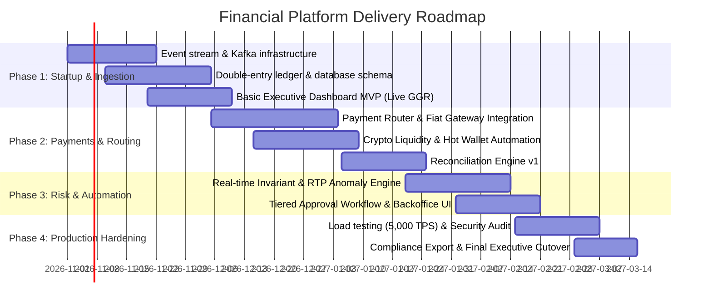

# Implementation Roadmap, Throughput Efforts & Startup Phase

## 1. Project Phase Breakdown & Milestone Schedule

The rollout is structured into four sequential phases designed to deliver immediate financial visibility in the startup phase while safely maturing into a fully automated payment and risk powerhouse.

---

## 2. Phase-by-Phase Deliverables

### Phase 1: Startup Phase (Weeks 1 - 4) — "Financial Ingestion & Live Cockpit"
- **Focus**: Connect the game backend/RGS (`ice_fishing` and core platform) to an event stream.
- **Key Deliverables**:
  1. Kafka event emitters on RGS for `bet.placed`, `round.settled`, and `wallet.debited`.
  2. Double-entry PostgreSQL ledger service with ACID transactional safety.
  3. Executive Web Dashboard (v1) showing live turnover, GGR, player count, and game RTP deviation.
  4. Basic alert webhooks (Slack / Telegram / Email) for critical RTP breaches.

### Phase 2: Payment Gateway & Settlement (Weeks 5 - 8) — "Liquidity & PSP Orchestration"
- **Focus**: Automate deposits, payment routing, and operational float monitoring.
- **Key Deliverables**:
  1. Smart Payment Router integrating primary fiat gateways + crypto custody (USDT/BTC).
  2. Hot/Warm wallet balance telemetry with auto-replenishment notifications.
  3. Daily 3-way automated reconciliation (RGS vs Ledger vs Gateway reports).

### Phase 3: Risk, Anomaly & Approvals (Weeks 9 - 12) — "Guardrails & Loss Prevention"
- **Focus**: Protect capital from fraud, exploits, and runaway payout exposure.
- **Key Deliverables**:
  1. Invariant checking engine (balance monotonicity and round authentication).
  2. Withdrawal review dashboard with 1-click approvals for Tier 1 & dual-sign-off for Tier 3.
  3. Real-time velocity tracker (multi-accounting, rapid cashouts, syndicates).

### Phase 4: Production Hardening & Compliance (Weeks 13 - 16) — "Enterprise Scale"
- **Focus**: Stress-testing, security penetration testing, and statutory compliance.
- **Key Deliverables**:
  1. 5,000 TPS benchmark testing and disaster-recovery drills.
  2. Third-party financial audit logging compliance (tamper-evident hash chaining).
  3. Final executive sign-off and operational handoff.

---

## 3. Resource Estimation & Throughput Efforts

### Engineering & Domain Team Allocation (Estimated FTEs):
- **1x Lead Financial Systems Architect** (Full-time: Architecture, ledger integrity, compliance).
- **2x Senior Backend Engineers** (Distributed systems, Go / Rust / Python, Kafka, PostgreSQL).
- **1x Senior Payments Integration Engineer** (PSP APIs, webhooks, crypto custody protocols).
- **1x Senior Frontend Engineer** (React / TypeScript, WebSocket telemetry, Tailwind, high-density charts).
- **1x Data / Analytics Engineer** (ClickHouse, Flink, real-time aggregation models).
- **1x QA / Performance Engineer** (Chaos engineering, high-volume load simulation).

### Throughput & Sprint Sizing (Story Points & Man-Days):

| Milestone / Module | Man-Days Estimate | Complexity | Critical Dependencies |
|---|---|---|---|
| **Event Streaming & Ledger Backbone** | 35 days | High | Core game platform event hooks |
| **Executive Real-time Dashboard UI** | 25 days | Medium | Metric WebSocket API |
| **Payment Gateway & Router Core** | 40 days | High | PSP Sandbox accounts & KYC flows |
| **Automated Reconciliation Engine** | 20 days | Medium | Bank statement parsers |
| **Fraud & Invariant Rule Engine** | 30 days | High | Real-time stream integration |
| **Security, HSM Vault & Audit Logs** | 20 days | High | Key vault infrastructure |
| **Testing, Load Simulation & Launch** | 20 days | Medium | Full end-to-end sandbox |
| **Total Effort** | **190 Man-Days** | | (~16 calendar weeks with 6 FTEs) |

---

## 4. Immediate Startup Phase Action Items

1. **Repository Setup**: Initialize the dedicated financial backend service and dashboard UI in the repository.
2. **Event Schema Alignment**: Finalize the protobuf / JSON event schema with the game engine team (`platform/rgs` and `platform/server`).
3. **Database Schema Creation**: Deploy PostgreSQL double-entry ledger migrations and test ledger invariant consistency under simulated concurrency.
4. **Dashboard Prototype**: Wire up live WebSocket ticker cards to validate executive feedback.
